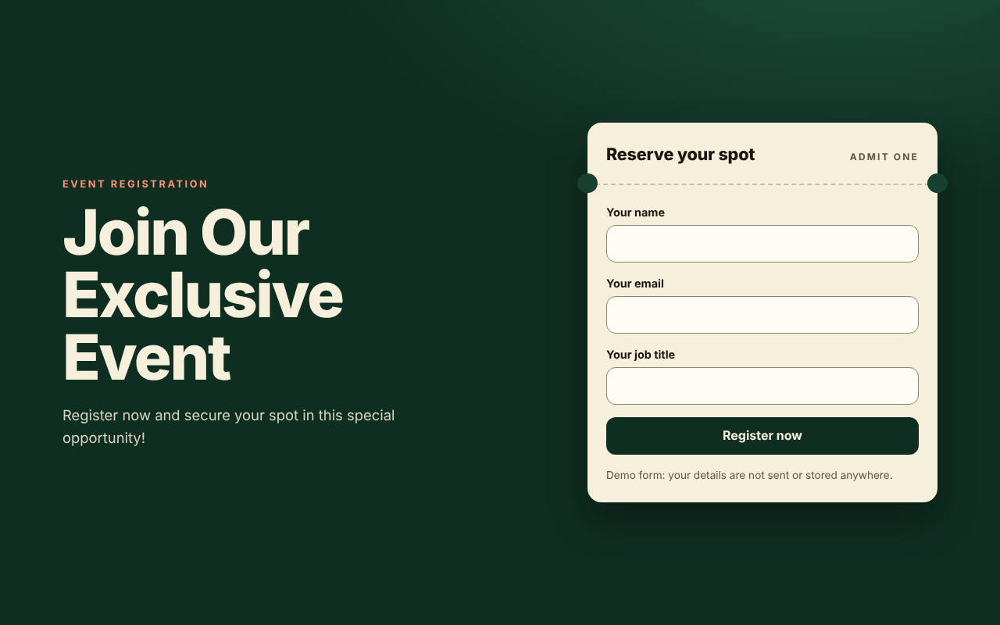
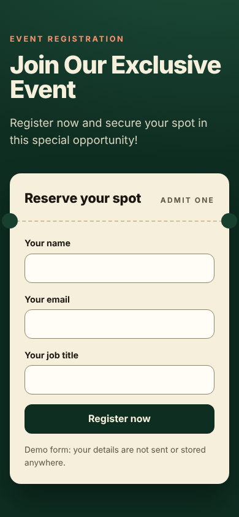

# Event Registration Page

A one-page event landing page with a short registration form (name, email, job title), plus the two files Brevo needs for web push notifications. Plain HTML, CSS and JavaScript, no build step, no dependencies.

Live demo: https://events1-theta.vercel.app





## Important: the form is a demo

The registration form validates in the browser and shows an inline success message. **It does not send or store anything.** The original code showed `alert("Your registration has been received")` and then discarded the data, which was misleading, so the success message and a note under the form now say plainly that this is a demo. To collect real registrations, post the form to a backend or use a Brevo form (not set up here).

## The Brevo parts

- `index.html` loads Brevo's tracker (`https://cdn.brevo.com/js/sdk-loader.js`, `async`) and initialises it with a `client_key`. This is the Brevo tracker snippet. The page works without it, for example when the script is blocked.
- `brevo-frame.html` and `sw.js` are the two setup files Brevo asks you to host at the site root for web push notifications (see [Brevo: set up web push notifications](https://help.brevo.com/hc/en-us/articles/4609653630354)). `brevo-frame.html` is unchanged. Do not rename or move either file.
- The `client_key` in `index.html` was already committed in the original repo. Brevo's tracker snippet is meant to be placed in page source, but I could not confirm in Brevo's documentation that this key is non-secret. If you are unsure, check it in your Brevo account (and regenerate it if needed).

## Service worker (`sw.js`)

- Loads Brevo's SDK and initialises it with the key from `sw.js?key=...`.
- Caches nothing and does not handle `fetch`, so it cannot serve stale pages.
- `skipWaiting()` and `clients.claim()`: a new version of the worker activates immediately.
- The CDN import and the key are guarded, so a blocked CDN or a missing key no longer throws during install.
- `vercel.json` serves `/sw.js` with `Cache-Control: no-cache, max-age=0, must-revalidate`.

## Run it

```sh
python3 -m http.server 5266
# open http://localhost:5266
```

## Verification

Headless Chromium (Playwright) at 1280x800 and 390x844: empty and invalid submissions show inline messages and focus the first invalid field, a valid submission shows the inline success state (no `alert()` dialog), "Fill in the form again" restores the form, no page errors, no horizontal scroll on mobile. I registered `sw.js?key=test` locally and it installed and activated even with the Brevo CDN unreachable. I could not reach Brevo from the sandbox, so I did **not** verify the Brevo tracker, push subscription, or the response headers on Vercel. There are no automated tests in the repo.

## Known limitations

- Registrations are not collected (see above).
- No event date, venue or agenda is shown because none exists in the original page. Add the real details before promoting it.
- Web push needs HTTPS and a verified Brevo setup.

## Notes

UI and code quality improvements were made with AI assistance (Claude, Anthropic), reviewed and verified by building and running the app.
